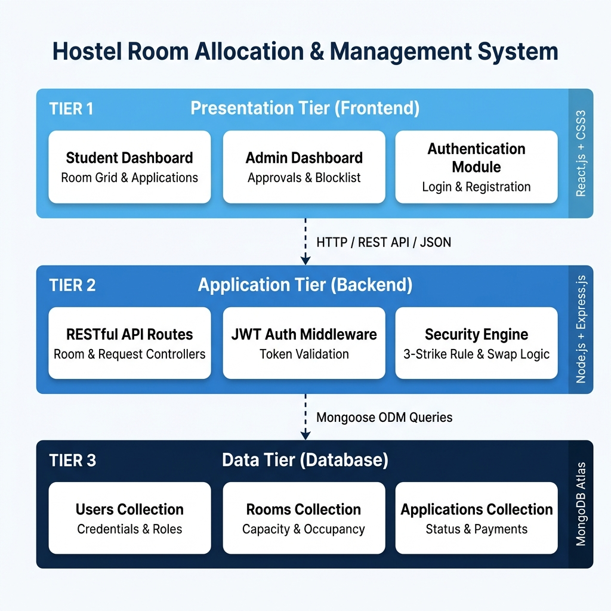
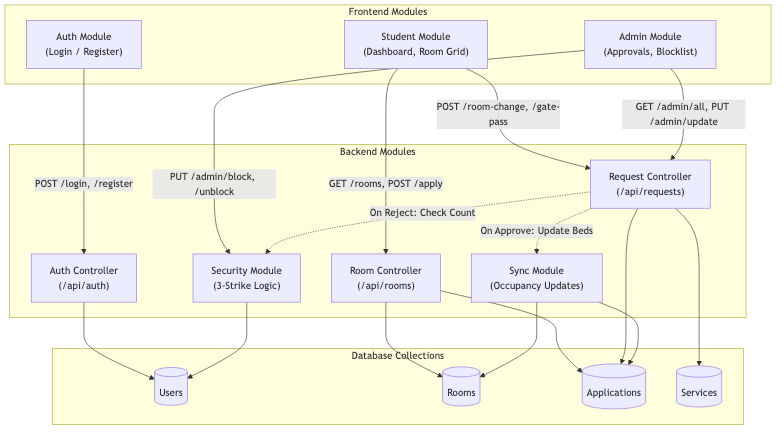
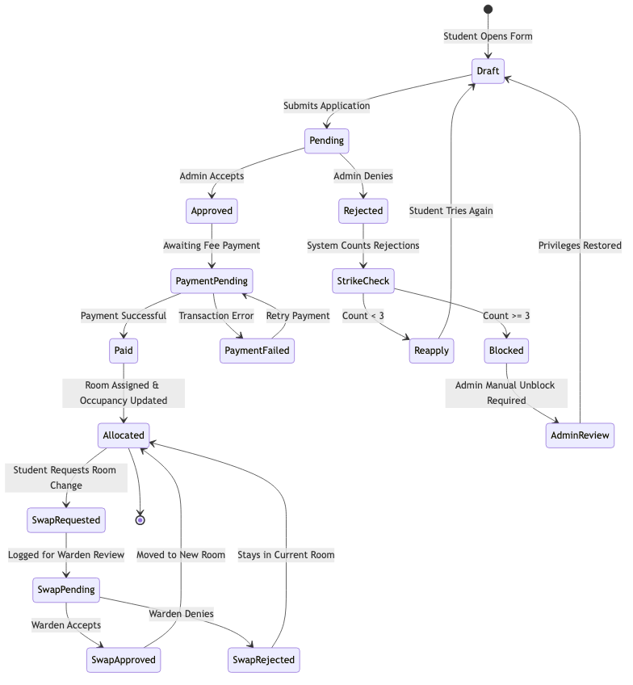
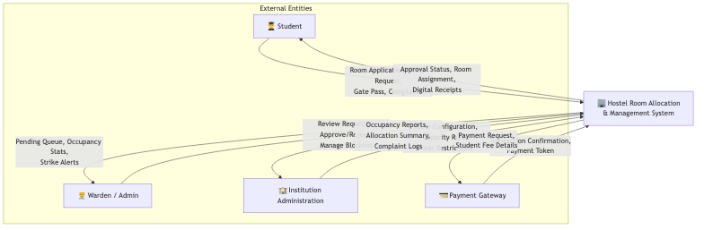

# HostelAlloc — Hostel Room Allocation & Management System

A professional, real-time MERN stack application for managing hostel room allocations, student requests, and administrative operations efficiently with strict policy constraints (such as the 3-strike security block and manual swap approvals).

---

## 📋 Table of Contents
1. [Tech Stack](#-tech-stack)
2. [Problem Statement](#-problem-statement)
3. [Abstract](#-abstract)
4. [Introduction](#-introduction)
5. [Core Features](#-core-features)
6. [System Architecture & UML Diagrams](#-system-architecture--uml-diagrams)
7. [System Requirements](#-system-requirements)
8. [Hardware & Software Requirements](#-hardware--software-requirements)
9. [Modules & Work Distribution](#-modules--work-distribution)
10. [Setup & Installation](#-setup--installation)

---

## 🚀 Tech Stack

- **Frontend**: React.js (Vite), Axios, React Router DOM
- **Backend**: Node.js, Express.js
- **Database**: MongoDB (Mongoose ODM)
- **Styling**: Vanilla CSS (Modern aesthetic with glassmorphism and responsive design)
- **Icons**: FontAwesome 6.4.0

---

## 🛑 Problem Statement
Traditional hostel management systems rely heavily on manual paperwork or disconnected spreadsheets. This leads to:
- **Inefficiency**: Delayed room allocation and manual tracking of swap requests.
- **Data Inconsistency**: Discrepancies between physical occupancy and database records.
- **Security Gaps**: No mechanism to prevent multiple rejections or track problematic student behaviors.
- **Lack of Transparency**: Students cannot view real-time room availability before applying.

---

## 📝 Abstract
The **Hostel Room Allocation & Management System** is a full-stack MERN application designed to streamline student housing. It introduces an intelligent room selection grid where students can view availability filtered by their academic year. Key innovations include a **Manual Swap Approval Engine**, moving away from automated changes to ensure warden oversight, and a **3rd Strike Security Logic** that automatically restricts users after multiple application rejections. The system utilizes a robust synchronization layer to ensure that every approval instantly updates room occupancy counts across the entire platform, providing a "Single Source of Truth" for administrators.

---

## 🚀 Introduction
In large-scale educational institutions, managing hostel occupancy is a critical logistical challenge. This project aims to replace legacy methods with a modern, responsive web application. By leveraging **React.js** for the frontend and **Node.js/Express** for the backend, the system offers a seamless experience for both students and wardens. The primary goal is to enforce strict academic year segregation (preventing senior/junior mixing) while providing the flexibility of room change requests under administrative supervision.

---

## 🛠️ Core Features

### 👤 Student Dashboard
- **Room Selection Interface**: A visual, color-coded grid filterable by block and year of study.
- **Application Tracking**: Real-time status updates (Pending/Approved/Rejected) with floor and room details visible upon approval.
- **Room Change Request**: Swap request logging for occupied rooms under manual warden review.
- **Service Requests**: Integrated modules for **Gate Passes** (Local/Vacation), **Guest Accommodation**, and **Complaints Management**.
- **Payment Gateway**: Mock integration for hostel fee processing.
- **3-Strike Safety**: Automatic blocking of applications after 3 rejections to prevent system abuse.

### 👑 Admin Dashboard
- **Room Occupancy Overview**: 12-floor interactive visualization for Blocks A & B with real-time occupancy indicators.
- **Request Management Panel**: Centralized tabs to manage all incoming student requests:
  - **Applications**: Review and allocate rooms to new students.
  - **Passes**: Approve or reject gate and vacation passes.
  - **Guests**: Manage external visitor stay requests.
  - **Swaps**: Review and force-approve room exchange requests.
  - **Complaints**: Track and resolve maintenance or service issues.
- **System Stats**: Real-time cards showing total students, occupancy rate, and vacancy counts.

### 🏢 Informational Pages
- **Hostel Gallery**: Real-view curated images of the building, mess, gym, and rooms.
- **FAQ & Rules**: Comprehensive guide on hostel conduct and common queries.
- **Staff & Contact**: Direct access to emergency numbers and administrative staff details.

---

## 🏗️ System Architecture & UML Diagrams

### 1. Three-Tier MERN Architecture Diagram
The system separates Presentation, Application Logic, and Data layers cleanly to maintain data integrity and security.



### 2. Module Interaction Diagram
Visualizes how the frontend UI modules communicate with backend controllers and database collections.



### 3. Application State Transitions
The lifecycle of a room application request from submission to allocation and potential 3-strike blocking.



### 4. System Context Diagram
Shows how the system fits into institutional operations, interacting with students, wardens, payment gateways, and university administration.



---

## 🛠️ System Requirements

### Functional Requirements
- **Student Dashboard**: Real-time room selection, gate pass application, and swap request tracking.
- **Admin Dashboard**: Comprehensive request management (Passes, Guests, Swaps, Complaints).
- **3-Strike Blocking**: Automatic blocking of students after 3 rejections in room applications or swaps.
- **Manual Approval Workflow**: All room changes must be reviewed and accepted by an admin.
- **Real-time Occupancy Sync**: Backend logic to increment/decrement bed counts upon approval.

### Non-Functional Requirements
- **Data Integrity**: Ensures no room exceeds its defined capacity.
- **Security**: Password hashing via `bcrypt` and role-based access control (RBAC) via JSON Web Tokens (JWT).
- **Responsiveness**: Cross-device compatibility for mobile and desktop users.
- **Reliability**: Atomic database operations to prevent stale room counts.

---

## 💻 Hardware & Software Requirements

### Software Requirements
- **Runtime**: Node.js (v20+)
- **Database**: MongoDB Atlas (NoSQL)
- **Frontend Framework**: React.js 18+
- **Styling**: Vanilla CSS3 with Modern Layouts
- **API Testing**: Postman / Automated JS scripts

### Hardware Requirements
- **Processor**: 2.0 GHz or higher
- **RAM**: 8GB (recommended for development)
- **Storage**: SSD with at least 500MB free for project files
- **Connectivity**: Stable internet for Database-as-a-Service (Cloud Atlas)

---

## 👥 Modules & Work Distribution

| Team Member | Module Responsibilities | Key Contributions |
| :--- | :--- | :--- |
| **Member 1** | **Frontend Architect** | Student Dashboard UI, Room Selection Grid, Auth Context Integration. |
| **Member 2** | **Admin Experience Dev** | Admin Dashboard, Request Filter Logic, Blocklist Management UI. |
| **Member 3** | **Backend Logic Engineer** | Room Allocation API, Swap Request Handler, Capacity Validation. |
| **Member 4** | **Security & Data Dev** | 3-Strike Rule Logic, Database Sync Scripts, MongoDB Schema Design. |

---

## 📦 Setup & Installation

1. **Clone the repository**:
   ```bash
   git clone <repository-url>
   cd "FP CSBS"
   ```

2. **Backend Setup**:
   ```bash
   cd backend
   npm install
   # Ensure MongoDB is running locally or configured
   node seed.js  # Build the 12-floor room hierarchy and test data
   node server.js
   ```

3. **Frontend Setup**:
   ```bash
   cd ../frontend
   npm install
   npm run dev
   ```
